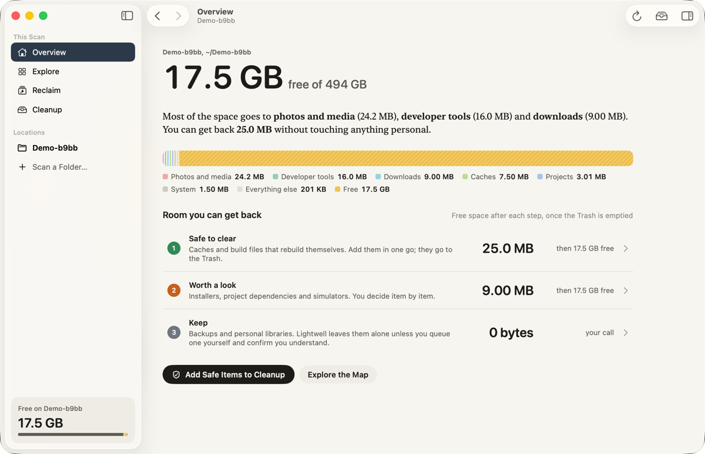
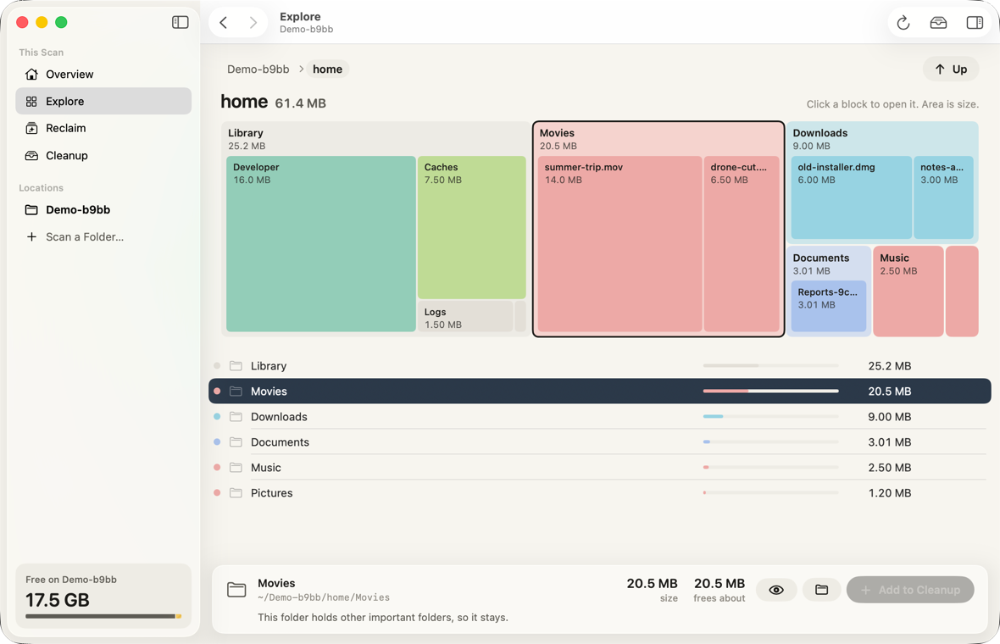
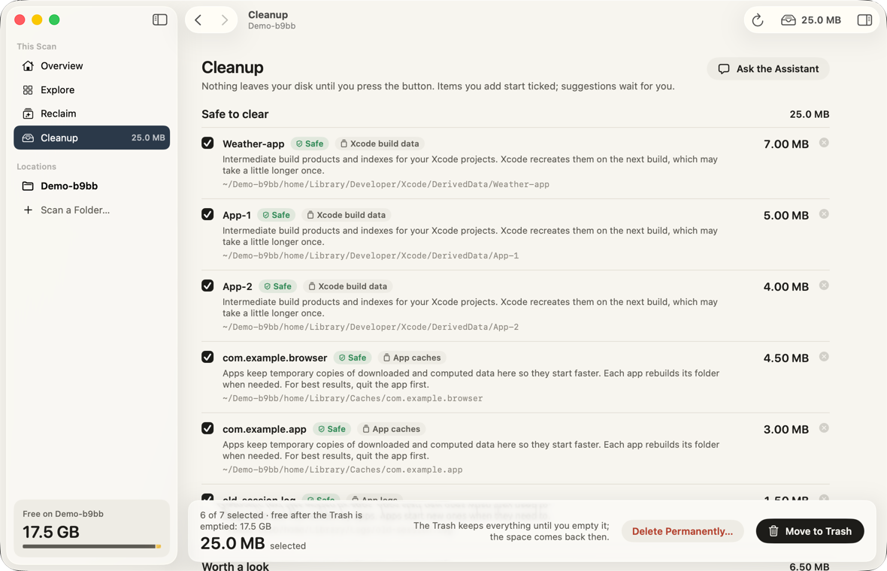
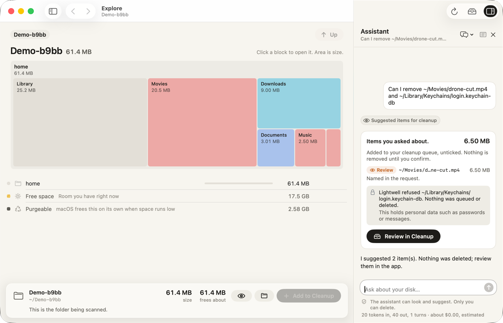

# Lightwell

Lightwell is a native macOS app that shows what is using space on your Mac and helps you get it back safely. It scans a whole disk or a single folder, draws a space map you can click through, groups reclaimable files into categories with clear risk levels, and lets you review everything in a cleanup queue before anything leaves your disk.

It also has an optional assistant that runs on the `claude` command line tool you already use, with your own Claude login. You can ask it about your disk in plain words and it suggests items for you to review. It never deletes anything.

Lightwell is for anyone whose Mac keeps running out of room, and especially for developers whose disks fill up with build products, caches, simulators and package folders.

Status: early development (version 0.1.0). There is no prebuilt download yet, so you build it from source.

## Screenshots

These come from the real app, running its real scanner against a small generated test folder (`Demo-b9bb`).









## Features

### Scanning

- Scan any mounted volume from the start screen, or any folder with Scan a Folder (Cmd+O).
- A fast native engine built on `getattrlistbulk`, running on a small pool of worker threads.
- Honest accounting: every hard-linked file is counted once, APFS clones share their common blocks once per clone family, firmlinks are never counted twice, symlinks are never followed and scans never cross into other mounted volumes.
- The overview explains the whole disk: free space, purgeable space (shown for information, macOS manages it), and space that is hidden or unreadable.

### Explore

- A squarified treemap space map: every block's area is its size, and you click a block to open it. Tiny items are merged into one "smaller items" block per folder.
- A sorted list of the current folder next to the map, a breadcrumb, Back and Forward, and Up to the enclosing folder.
- An inspector for the selected item with its size, how much removing it would actually free, Quick Look and Reveal in Finder.

### Reclaim

- A built-in knowledge base of about 50 rules (app caches, Xcode build data, logs, installers, package manager caches, simulators and more) sorts what it finds into categories.
- Every item carries a risk level: Safe, Review, Keep or Locked. Safe items rebuild themselves; Review items are yours to judge; Keep items stay unless you queue one yourself and confirm that you understand; Locked items are never removed.
- One click adds all Safe items to the cleanup queue. Things a tool manages better (simulators, Homebrew, npm and similar) come with the command to run instead of a file deletion.

### Cleanup queue

- Nothing leaves your disk until you press the button. Items you add yourself start ticked; anything the assistant suggests starts unticked.
- Move to Trash is the default. Delete Permanently is a separate, explicit choice with a 5 second countdown you can stop.
- Every item is checked again right before it is moved: anything that changed since the scan, is protected, or has the macOS locked flag is skipped and reported, and the locked flag is never cleared. Removing a symlink removes only the link.
- A result report after each run, and a list of recently trashed items you can still delete permanently.

### Safety model

- Protected paths: system locations, your personal data (keychains, mail, messages, photos libraries and similar), cloud-synced folders, backups, read-only volumes and the folder you are scanning cannot be queued, by you or the assistant.
- The protection check runs three times: when an item is added, when the assistant proposes it, and again right before each move or delete.
- A hard-linked file or an APFS clone frees its shared bytes only when every copy is queued, and the "frees about" estimate follows that rule, so the app never promises space it cannot give back.

### Live refresh

- Lightwell watches the scanned folder with FSEvents and updates the tree in place a few seconds after files change.
- When the disk changes in too many places to follow one by one, it runs a full refresh, at most once every 5 minutes. The toolbar shows when the next one is due, and Refresh Now runs it right away.

### Full Disk Access

macOS hides some folders (Mail, Messages, Safari data, other users' files) from apps unless you grant Full Disk Access. Lightwell works without it and shows those folders as restricted. A short onboarding explains why access helps, opens the right page in System Settings, gives you an app icon to drag into the list, and relaunches the app when you are done.

### The assistant

- Optional and off until you read and accept a consent screen.
- Runs your local `claude` CLI as a child process, signed in with your own Claude account. Lightwell never asks for or stores an API key: API key variables are removed from the environment it gives `claude`, and with Block API keys on (the default) a conversation stops if Claude Code would bill an API key instead of your login.
- Sees only file and folder names, paths and sizes from your scan, through a small set of read-only tools served by the bundled `lightwell-mcp` helper. Claude Code's own tools (file reading, shell and so on) are switched off, so it never reads what is inside your files.
- Can only propose items for the cleanup queue. Proposals land unticked, protected items are refused, and you confirm every removal yourself.
- Settings for the model, steps per question, an optional spending guard per conversation, and a toggle to turn the assistant off.

## Requirements

- macOS 26 or later on Apple silicon
- Xcode 27 (Swift 6.4)
- [XcodeGen](https://github.com/yonaskolb/XcodeGen)
- Optional, for the assistant: [Claude Code](https://docs.anthropic.com/en/docs/claude-code) (the `claude` CLI), signed in with your Claude account

## Build from source

```sh
brew install xcodegen
git clone https://github.com/superalex051/lightwell.git && cd lightwell

# Optional but recommended: sign with your own Apple Development certificate
cp Config/Signing.local.xcconfig.example Config/Signing.local.xcconfig
# then edit it: set DEVELOPMENT_TEAM to your team id
# (security find-identity -v -p codesigning lists your identities)

make gen build    # generate Lightwell.xcodeproj from project.yml, then a Release build into build/
make install      # quit a running copy and copy the Release app to /Applications
```

Tests and checks:

```sh
make test         # unit tests for Packages/Kit (Swift Testing)
make lint         # dashes, secrets, environment dumps, string catalog keys
make verify       # codesign checks on the Release app and its embedded helper

swift build --package-path Packages/Kit --product fake-claude   # the claude test double the UI tests use
make uitest       # XCUITest: screens on preview data plus fixture-mode end-to-end scenarios
```

`make uitest` needs a real signing identity in `Config/Signing.local.xcconfig`: with ad hoc signing the test runner and the app end up with different team ids and the runner refuses to start. The end-to-end scenarios use the `fake-claude` double from `Packages/Kit/.build/debug`, so build it first (a full `make test` builds it too). All test data lives in temporary fixture folders that the tests delete.

Other targets: `make debug` (Debug build), `make ci` (gen, lint, test, build, verify, uitest), `make bench` (scanbench on your home folder, read only) and `make clean`.

### Signing and Gatekeeper

Without `Config/Signing.local.xcconfig` the app is signed ad hoc, which is enough to run it on the Mac that built it. With your own Apple Development certificate the build also runs only on your own Mac. There is no notarized Developer ID download yet, so for now please build from source. `Signing.local.xcconfig` is gitignored, so your team id stays on your machine.

## Architecture

The app is a thin SwiftUI layer; the logic lives in one Swift package, `Packages/Kit`, with one target per concern:

| Module | What it does |
| --- | --- |
| `ScanKit` | Scanner, compact scan tree, hard link and clone accounting, firmlinks, volume catalog, FSEvents live refresh, queries |
| `RulesKit` | The cleanup knowledge base (`rules.json`), risk levels and the protected path policy |
| `CleanupKit` | Cleanup queue, the executor that revalidates and moves or deletes, deletion reports |
| `VizKit` | Squarified treemap layout and the space map view |
| `IPCProtocol` | The assistant's tool catalog and the messages between app and helper |
| `MCPServerKit` | The stdio MCP server behind the `lightwell-mcp` helper |
| `AIBridge` | Finds `claude`, builds its command line, runs the session, parses stream-json, serves the helper over a verified Unix socket |
| `AppCore` | Observable models that tie it all together for the screens |
| `TestSupport` | Fixture folders and test helpers |
| `scanbench`, `mcp-helper`, `fake-claude` | A scan benchmark, the helper entry point for tests, and a deterministic stand-in for `claude` |

Other folders: `App/` (the SwiftUI app: screens, theme, string catalogs), `Helpers/MCPHelper` (the helper embedded in `Lightwell.app/Contents/Helpers`), `UITests/`, `Config/` (xcconfigs and entitlements), `scripts/`, `design/` (the design mockup and notes) and `PLAN.md` (the build plan).

How the assistant is wired: the app starts `claude` with stream-json input and output, no settings sources, no built-in tools and a strict MCP config that lists only the bundled helper. The helper speaks MCP to `claude` on stdio and forwards each tool call to the app over a Unix socket. The app accepts the connection only from a peer with the expected code signature and a per-session nonce.

## Safety and privacy

- Scanning reads names, sizes and file attributes. Lightwell never opens your files to read their contents.
- Nothing is removed without your confirmation. The Trash is the default, permanent deletion sits behind a countdown, and protected paths cannot be queued at all.
- No analytics, no telemetry, no network calls of its own. The only data that leaves your Mac is what the assistant sends to Anthropic through your own `claude` login, and only after you accept the consent screen: file and folder names, paths and sizes from your scan.
- The app is not sandboxed (it needs Full Disk Access and must start `claude`), and runs with the hardened runtime.

## Contributing

Issues and pull requests are welcome. Please read [AGENTS.md](AGENTS.md) first: it has the house rules (string catalogs, no em or en dashes, no secrets or environment values in output, tests only in temporary fixture folders) and the build and test commands.

## Clean room

Lightwell is an independent project written from scratch, inspired by the idea of visual disk analyzers such as DaisyDisk. It is not affiliated with, endorsed by or derived from DaisyDisk or its developers. No code, artwork, palette or wording from other apps is used.

## License

MIT, see [LICENSE](LICENSE).
